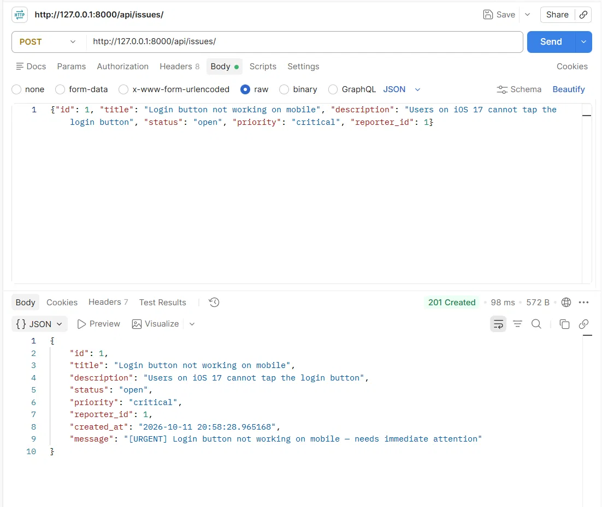
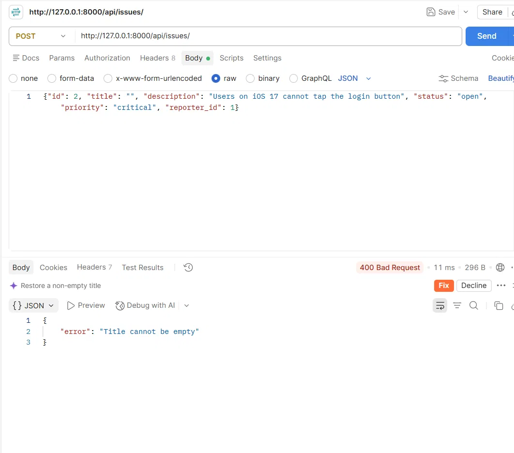

# DevTrack

A minimal Django backend API for tracking engineering issues (a stripped-down GitHub Issues).
Data is stored in two JSON files: `reporters.json` and `issues.json`. No database needed.

## How to run

```bash
python -m venv venv
venv\Scripts\activate        # Windows
# source venv/bin/activate   # Mac/Linux
pip install -r requirements.txt
python manage.py runserver
```

API runs at `http://127.0.0.1:8000/api/`.

## Endpoints

| Method | URL | What it does |
|---|---|---|
| POST | `/api/reporters/` | Create a reporter |
| GET | `/api/reporters/` | List all reporters |
| GET | `/api/reporters/?id=1` | Get one reporter (404 if missing) |
| POST | `/api/issues/` | Create an issue; response includes `message` from `describe()` |
| GET | `/api/issues/` | List all issues |
| GET | `/api/issues/?id=1` | Get one issue (404 if missing) |
| GET | `/api/issues/?status=open` | Filter issues by status |

Status codes: `201` created, `400` validation error, `404` not found.

### Sample requests

```json
POST /api/reporters/
{"id": 1, "name": "Panda", "email": "panda@test.com", "team": "backend"}

POST /api/issues/
{"id": 1, "title": "Login button not working on mobile",
 "description": "Users on iOS 17 cannot tap the login button",
 "status": "open", "priority": "critical", "reporter_id": 1}
```

## OOP design

- `BaseEntity` (abstract): `validate()` is abstract, `to_dict()` is shared.
- `Reporter` and `Issue` inherit from it.
- `CriticalIssue` and `LowPriorityIssue` subclass `Issue` and override `describe()`.

## Screenshots

Add Postman screenshots in `screenshots/`:

- Success: 
- Failure: 

## Design decision

<!-- Write your own here. Example: JSON file paths are built from Django's BASE_DIR,
so the files are always created in the project root no matter which directory the
server is started from. -->
